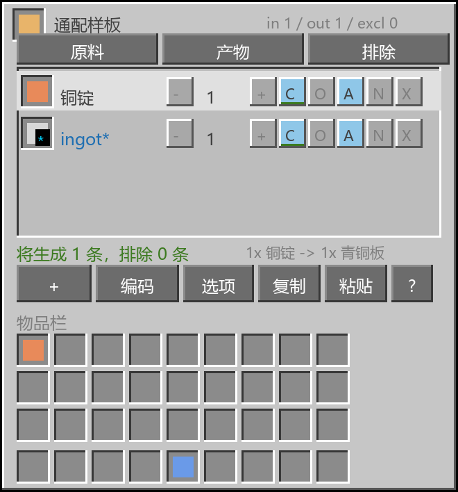
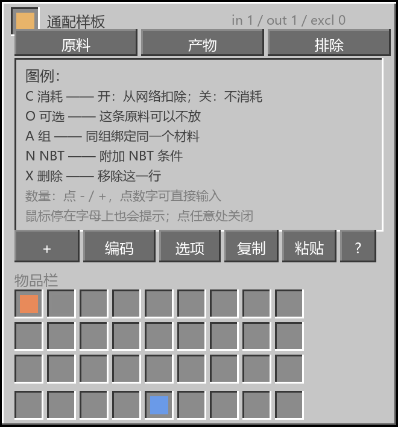

# AE2 通配样板 (Wildcard Pattern) — v2 规则版

Minecraft **1.20.1** / **Forge** 下的 AE2 附属模组：**一张通配样板 = 一套规则**，运行时按规则在内存里
展开成具体配方，而不是提前把所有具体样板编码出来。

> **v1 → v2 重做说明**：v1 的「一键批量编码出 N 个具体样板」方向已废弃。
> v2 只产出**一个**通配样板物品，规则存在它自己的 NBT 里，运行时由本模组的机器按规则工作。
> 设计方案见 [docs/DESIGN-v2.md](docs/DESIGN-v2.md)（含已确认的决定与实现状态）。

```
通配样板物品 ──右键──▶ 三标签页 GUI ──▶ 规则存进物品 NBT（服务端权威）
                                          │
                        通配样板供应器（P2）──▶ 运行时按规则实例化 ──▶ AE2 合成 CPU
```

---

## 1. 现在能用什么（P1 已交付）

| 功能 | 状态 |
| --- | --- |
| 通配样板物品（不是 AE2 样板，AE2 编码终端既不能生成也不能编辑它） | ✅ |
| 右键打开**三标签页 GUI**：原料 / 产物 / 排除 | ✅ |
| 规则存进物品 NBT，退出重进、服务器重启都不丢 | ✅ |
| 服务端权威 + 客户端镜像同步（revision 协议，客户端改不了真相） | ✅ |
| 匹配器：具体物品 / 标签 / **族通配**（`ingot*`、`plate*`…/ 模组） | ✅ |
| 每个原料：数量、是否消耗、是否可选、**组**（同组=同材料绑定）、NBT 子集 | ✅ |
| 产物：匹配器、数量、组、NBT | ✅ |
| 排除页：具体物品 / 产物 / 材料名 / 模组 / NBT / **原料×产物组合** | ✅ |
| 实时预览：`将生成 N 条，排除 M 条` + 首条示例 | ✅ |
| **通配样板编码器方块**：只产出**一张**通配样板（可配置消耗 1 个 AE2 空白样板） | ✅ |
| 复制/粘贴规则（= SNBT 导出/导入，走系统剪贴板） | ✅ |
| **从物品栏快速录入**：拖到列表 / Ctrl+左键点物品栏格子 | ✅ |
| **JEI 拖入**：从 JEI 把物品拖到规则列表（JEI 可选，不装也能用） | ✅ |
| 命令：`/wildcardencoder rules\|preview\|export\|import\|give\|families\|variants` | ✅ |
| 中英双语（含**所有报错/警告**与标题栏`原料/产物/排除`汇总：服务端只发翻译键，客户端按语言显示） | ✅ |
| 界面：AE2 15 风格（浅色容器 + 图例 + 每个开关悬停有说明） | ✅ |
| 通配行图标**轮流显示它匹配到的物品**（如 `ingot*` 在铁/铜/锡…之间循环），右下角带类型角标 | ✅ |
| 匹配器浮层：**最上方是可点击展开的搜索栏**，下面是类型按钮，再下面是 3 行 18px 结果行（带物品图标），完全收在内容区内 | ✅ |
| **通配样板供应器**（接进 ME 合成、运行时内存实例化、排除生效、不消耗） | ✅ |
| 供应器**返回槽**：机器自动弹出的产物会被送回 ME 网络（与 AE2 原版供应器一致） | ✅ |

**没有做的事**（正是 v2 要避免的）：❌ 编码时穷举组合、❌ 批量生成具体样板物品、❌ 只做客户端 GUI。

### 界面风格与图例

界面按 **AE2 15 的 UI 规格**重做（直接取它自己的数值）：面板 `#C6C6C6`、凹槽 `#8B8B8B`
（`#373737` / `#FFFFFF` 立体边）、黑色描边；文字用它 `screens/common/palette.json` 里的调色板
（正文 `#404040`、次要 `#7E7E7E`、强调 `#00D5FF`、报错 `#CE2401`）。

行尾的 `C / O / A / N / X` 是开关，**鼠标停上去会弹出说明**，按钮行的 `?` 打开完整图例：

| 字母 | 名称 | 开 → 关 |
| --- | --- | --- |
| `C` | 消耗 | 开：合成时从 ME 网络扣除这个原料；关：**不消耗**（合成后退回网络） |
| `O` | 可选 | 开：这条原料可以不放（会额外产生「不放它」的配方变体） |
| `A` | 组 | 同一组的条目绑定同一个材料（铁配铁、锡配锡） |
| `N` | NBT | 给这个匹配器加 NBT 条件（子集匹配） |
| `X` | 删除 | 移除这一行 |

数量是中间的 `[-] 1 [+]` 两个按钮（有按钮底，和 `C/O/A/N/X` 一样）：点 `-` 减一、点 `+` 加一，按住 Shift 每次 10；点**中间的数字**可以直接输入数量。悬停这三个位置都有对应提示。
物品行显示**本地化名称**（如「铜锭」）而不是长 id，原始 id 在悬停提示里。

下面两图是按 Java 里同一套常量渲染的**示意图**（不是游戏截图，沙箱里无法启动客户端）：





---

## 2. 安装

| 项目 | 值 |
| --- | --- |
| 文件 | `dist/wildcardencoder-2.0.2.jar`（157,195 字节） |
| SHA-256 | `C4B421A9EAF8C67E7029A1B659FC6AF98FAB4D778F64D5F9A193E52896BCAFCA` |
| 依赖 | Minecraft 1.20.1、Forge ≥ 47、**AE2 ≥ 15**（必需，`mods.toml` 已声明） |
| 可选 | **JEI** 15.x（只用于「从 JEI 拖入」，未安装时本模组功能完整） |
| 编译基线 | Forge **47.4.20** + AE2 **15.4.10** + JEI **15.20.0.129**，JDK 17 |

放进 `mods/` 即可。三个物品的配方**由配置决定**（见下面「合成表」一节），默认是：

```
Q G Q        Q = ae2:quartz_glass          石英玻璃
P B P        G = #forge:ingots/gold        任意金锭
Q G Q        P = ae2:calculation_processor 运算处理器
             B = ae2:blank_pattern         空白样板
```

> 旧的 v1 jar（`wildcardencoder-1.0.0.jar`）请删掉，两者不能同时装。

### 版本与变更

`dist/` 只放**当前版本**，历史构建挪到 `dist/old/`。每次改动都会递增 `mod_version`，
所以拿到 jar 就能确认版本：物品 tooltip 末尾显示 `Wildcard Encoder v2.0.1`，
也可以用 `/wildcardencoder version` 查（游戏日志里启动时也会打印一行）。

| 版本 | 变更 |
| --- | --- |
| **2.2.0** | 新增：**可配置合成表**。三个物品（编码器 / 供应器 / 空白通配样板）的配方改为按配置在服务器启动时生成（`RecipeManager.replaceRecipes`，公开 API），可改材料（物品 / 标签 / 空槽，9 项按行读）、改产量、或整体关闭；并用一个 `minecraft:tick` 进度把它们加进配方书。新增：编码器的空白样板拆成**两个开关** —— `encodeRequiresBlankPattern`（是否必须有）与 `encodeConsumesBlankPattern`（是否消耗），四种组合都可用。静态配方 JSON 已移除（配置是唯一来源） |
| 2.1.0 | 新增：供应器**返回槽**。原来我把对外物品面直接接成了样板槽、而且只收通配样板，所以机器自动弹出的产物会被直接拒收。现在对外物品面是返回槽（接收任意物品），服务端每刻把里面的东西注入 ME 网络（用 `IGrid.getStorageService().getInventory().insert(...)`，操作来源记为供应器本身，和 AE2 的做法一致）；破坏方块时样板槽与返回槽的物品都会掉出来，不再丢物品 |
| 2.0.9 | 修：带 NBT 的物品规则在编辑界面报「这个匹配器没有匹配到任何物品」。原因是我用**光物品**（`new ItemStack(item)`）去验证 NBT 模板，而配置/模式这类 NBT 只存在于真实物品堆上，等于把规则自己否掉了。现在解析候选物品时**不再用 NBT 过滤**；NBT 作为「输入键的条件」写进每条实例化配方，由 AE2 在合成时通过 `IInput.isValid` 判定（无 NBT 条件 = 接受任意配置） |
| 2.0.8 | 修：带 NBT 的物品（如格雷科技编程电路）识别错误。两个原因：① 从 JEI/物品栏录入时把 NBT 丢掉了，所以「配置 1」变成「任意配置」、最后解析成配置 0；② 运行时 `IInput.getPossibleInputs()` 在**有 NBT 时反而把精确键替换成了裸物品键**，于是 AE2 去网络里找一个「不带 NBT 的编程电路」——这种物品根本不存在，结果即使网络里有配置 0 的电路也无法参与合成。现在精确键优先、裸物品键作为第二选项，`isValid` 对无 NBT 条件放行任意配置 |
| 2.0.7 | 修：结果行右下角的 `n/总数` 页码与副标题叠在一起（副标题裁剪宽度没给页码留位置）。修：选中一个具体物品后点`#标签`/`族通配`会提示「没有匹配项」（查询里带着物品 id，标签/族里当然匹配不到）→ 现在改为列出**该物品真正属于的标签/族**（铜锭 → `#forge:ingots/copper`、`ingot*` 等），没有任何物品上下文时才退回列出该类型的全部条目（标签按名字排序、只列有内容的） |
| 2.0.6 | 优化：标题栏 `in/out/excl` 汇总改为翻译键，中文客户端显示`原料 1 / 产物 0 / 排除 0`。修：匹配器里的`物品`/`#标签`/`族通配`按钮**从来没生效**（确认时总是优先用选中那行的类型）→ 现在按类型**过滤结果列表**，生效的类型按钮下方有青色下划线，`#`/`@` 开头的输入自动切到标签/模组。新增：搜索栏与类型按钮的悬停说明 |
| 2.0.5 | 修：匹配器搜索框在关闭浮层后没有被移除，一直留在编辑器里显示成一个黑框（浮层控件只登记了按钮、没登记输入框，`closeOverlay` 就漏掉了它）。改：搜索栏移到浮层**最上方**，默认是收起的横条，**点一下才展开**成输入框；`Esc` 先收起搜索栏、再按一次才关浮层 |
| 2.0.4 | 修：匹配器浮层的结果列表还在用老布局的偏移，画到了状态行和底部按钮上（看起来又小又乱）→ 改成类型按钮 / 搜索框 / 3 行 18px 结果行，全部收在内容区里，带物品图标与 `n/总数` 提示。修：物品图标上的类型角标被物品盖住（角标画在 z=0、物品在 z≈150）→ 角标抬高图层 |
| 2.0.3 | 修：图例浮层上会透出行里的物品图标（物品画在更高图层，浮层盖不住 → 开浮层时不再绘制行内容，浮层本身也抬高图层）。新增：通配行（`#标签` / 族通配 / `@模组`）的图标**轮流显示它匹配到的物品**，右下角保留 `*`/`#`/`@` 角标 |
| 2.0.2 | 修：`-` / `+` 点击区之前是同一块、靠鼠标左右键区分，导致点 `-` 也是加；现在按位置分区并画成按钮。另：点数量数字可直接输入 |
| 2.0.1 | 修：从物品栏点击添加时会重复添加两条（按下与松开各加了一次）；版本号与查看方式 |
| 2.0.0 | 通配样板重做（P1 规则层 + 三标签页界面 + 编码器方块，P2 供应器 + 运行时实例化 + 不消耗），物品栏拖入 / Ctrl+点击 / JEI 拖入，AE2 15 风格界面与 `?` 图例，报错与警告中文化。**这一版号被打包过多次，无法区分具体构建**，请以 2.0.1 及之后的版本为准 |
| 1.0.0 | 最早的批量编码版本，方向已废弃，请勿使用 |

完整历史（含每个版本的具体改动）见 [CHANGELOG.md](CHANGELOG.md)；v2.2.0 的发行说明见 [docs/releases/v2.2.0.md](docs/releases/v2.2.0.md)。

---

## 3. 使用方法

1. 放下「通配样板编码器」，右键打开三标签页界面（或先 `/wildcardencoder give` 拿一张空白通配样板，
   右键它也能打开同一个界面）。
2. **原料页**：点 `+` 添加原料 → 在匹配器编辑器里选类型（物品/#标签/族通配/@模组）并搜索选择。
   每行的 `C`=是否消耗、`O`=是否可选、`A`=组、`N`=NBT、`X`=删除；点数量两侧 `+/-`（按住 Shift ×10）。
3. **产物页**：同样方式添加产物。
4. **排除页**：点 `+` 选择排除方式，把不想要的组合去掉。

### 四种录入方式

界面下半部分就是**玩家物品栏**，所以录入一个具体物品有四种办法：

| 方式 | 操作 | 适合 |
| --- | --- | --- |
| 搜索添加 | 点 `+`，在匹配器编辑器里按名字搜、写 `#标签` 或 `@模组` | 建 `ingot*` 这类通配、批量匹配 |
| 从物品栏拖入 | 在物品栏左键拿起物品，拖到上方列表松开 | 手里正好有那个物品 |
| Ctrl + 左键 | 直接 Ctrl+左键点物品栏里的物品，立刻添加（物品不会被拿起） | 连点多个物品 |
| 从 JEI 拖入 | 装了 JEI 时，把 JEI 里的物品拖到列表上松开（列表会被 JEI 高亮） | 在 JEI 里查配方时顺手加 |

加到哪个列表由**当前标签页**决定：原料页 → 原料，产物页 → 产物，排除页 → 「按物品排除」。
每次添加都会在状态行显示`已添加 <物品名>`。
5. 在方块界面里点「编码」→ 得到**一张**通配样板（规则写进它的 NBT）。
6. 合成「通配样板供应器」（样板供应器 + 运算处理器 + 石英玻璃 + 金锭），放进 ME 网络并接上频道。
7. 拿着通配样板**右键**供应器 → 装入；空手右键 → 显示`已装入 N 张，当前生效 M 条配方`；
   潜行空手右键 → 全部取回。供应器对外的物品面是**返回槽**：机器开着自动弹出时，产物会进这里并在下一个刻被注回 ME 网络（终端里就能搜到）。样板请用右键放入（对外的物品面不是样板槽）。
8. 之后在 ME 合成终端请求具体产物（例如 `copper_plate`），合成 CPU 会按规则规划并把输入推进相邻机器。

### 规则语义

- **族通配**：`ingot*` 会通过 Forge 物品标签（1.20.1 的矿物辞典）匹配 `forge:ingots/*` 的所有材料，
  所以「所有已注册金属」自动生效，无需配置。
- **组**：同一组的条目会绑定到**同一个材料**。所以把 `ingot*` 和 `plate*` 都设成 `A` 组，
  铁只配铁、铜只配铜；不同组之间互相独立（会做笛卡尔积，受上限保护）。
  如果某组没有共同变体，界面会提示并按独立处理，不会卡死。
- **带 NBT 的物品**：从 JEI / 物品栏拖入（或 Ctrl+点击）时，物品的 **NBT 会被一并记录**，
  所以「格雷编程电路（配置 1）」就是配置 1，而不是"任意配置"。行内 `N` 会亮起，按 `N` 可以查看/修改/清空这段 NBT
  （清空 = 任意配置，但 AE2 从网络里取物是按精确键取的，因此不带 NBT 的规则只能匹配网络里同样不带 NBT 的物品）。
- **排除**：在实例化**之前**求值，所以被排除的组合根本不会出现在 AE2 眼里。
- **可选输入**：默认关闭（AE2 没有「可有可无的输入」概念，只能靠多实例化表达），
  在「选项」里可开到最多 2 层。

---

## 4. 配置

`config/wildcardencoder-common.toml`：

| 配置项 | 默认 | 说明 |
| --- | --- | --- |
| `maxInstances` | `256` | 一张通配样板运行时最多展开成多少条配方 |
| `maxMatchedVariants` | `512` | 单个匹配器最多解析出多少变体 |
| `maxCandidatesPerVariant` | `64` | 每个变体保留多少候选物品（排序后取第一个作代表） |
| `maxAmount` | `1000000` | 单条规则的数量上限 |
| `allowModMatcher` | `false` | 是否允许 `@模组` 匹配器（可能命中几千个物品） |
| `allowAnyMatcher` | `false` | 是否允许 `*`（调试用） |
| `encodeRequiresBlankPattern` | `true` | 编码时**必须**持有 1 个 AE2 空白样板（关掉则不需要任何空白样板） |
| `encodeConsumesBlankPattern` | `true` | 需要时是否**消耗**它（关掉 = 当催化剂，编码后数量不变） |
| `preferredNamespaces` | `minecraft` | 代表物品的命名空间优先级 |
| `extraAliases` | 空 | 自定义族别名，`token=namespace:tagpath` |
| `commandPermissionLevel` | `2` | 命令所需权限等级 |

---

---

## 合成表（可配置）

三个物品的配方不是写死的 JSON，而是**按配置在服务器启动时生成**（`RecipeManager.replaceRecipes`），
所以你可以改材料、改产量、或者干脆关掉某个配方。改动在**世界加载或 `/reload`** 后生效。

| 配置项 | 默认 | 说明 |
| --- | --- | --- |
| `recipes.patternEncoderEnabled` | `true` | 是否可以合成「通配样板编码器」 |
| `recipes.patternEncoderIngredients` | 见下 | 配方材料，9 项按行读 |
| `recipes.patternEncoderCount` | `1` | 一次合成产出几个 |
| `recipes.patternProviderEnabled` | `true` | 是否可以合成「通配样板供应器」 |
| `recipes.patternProviderIngredients` | 见下 | 同上 |
| `recipes.patternProviderCount` | `1` | 同上 |
| `recipes.wildcardPatternEnabled` | `true` | 是否可以**直接**合成空白通配样板（不想用编码器时很方便） |
| `recipes.wildcardPatternIngredients` | 见下 | 同上 |
| `recipes.wildcardPatternCount` | `1` | 同上 |

材料写法（9 项，按行从左到右）：

| 写法 | 含义 |
| --- | --- |
| `"ae2:quartz_glass"` | 指定物品 |
| `"#forge:ingots/gold"` | 某个标签下的任意物品（矿物辞典） |
| `""` | 空槽 |

空白的边缘行列会被自动裁掉，所以写 2×2 就是 2×2（不必凑满 9 项）；整张表都空则该配方不生成。
无效的物品/标签会在日志里告警并当作空槽。默认配方：

```
编码器                          供应器                          空白通配样板
Q G Q        Q = 石英玻璃        Q P Q        Q = 石英玻璃        G Q G        G = 任意金锭
P B P        G = 任意金锭        G B G        G = 任意金锭        Q B Q        Q = 石英玻璃
Q G Q        P = 运算处理器      Q P Q        P = 运算处理器      G Q G        B = 空白样板
             B = 空白样板                     B = 样板供应器                    （未编码，右键配置规则）
```

> 小提示：模组顺带用一个 `minecraft:tick` 触发器的进度把这几个配方加进了**配方书**，
> 所以即使配方是运行时生成的，配方书和 JEI 里也都能看到（关掉的配方不会出现）。

---

## 5. 命令

```
/wildcardencoder rules                打印主手通配样板的规则
/wildcardencoder preview [limit]      按规则实例化并列出配方（默认 10 条）
/wildcardencoder export               把规则导出成 SNBT（可复制）
/wildcardencoder import <snbt>        把 SNBT 导入主手的通配样板
/wildcardencoder give                 给自己一张空白通配样板
/wildcardencoder families             列出内置族别名
/wildcardencoder variants <family>    列出某族的全部变体（例：variants ingot）
```

---

## 6. 代码结构

```
src/main/java/com/ae2wildcard/encoder/
├── rule/            规则层（纯数据，可单测）
│   ├── WildcardRules.java   Match/MatchKind/Input/Output/Exclude/Options/NbtMatch
│   └── RuleCodec.java       NBT + SNBT 序列化，带 we_ver 版本号
├── craft/           匹配与实例化引擎（与 AE2 解耦）
│   ├── TagIndex.java        标签快照 + 变体推导（沿用 v1 核心资产）
│   ├── WildcardAliases.java ingot* -> forge:ingots 等别名表
│   ├── VariantResolver.java 匹配器 -> {变体 -> 候选物品}
│   ├── PatternInstantiator.java 变体绑定 + 笛卡尔积 + 上限 + 可选展开
│   ├── ExclusionFilter.java 排除求值（物品/模组/变体/NBT/组合/产物）
│   ├── ResolvedPattern.java 一条内存配方（不是物品）
│   └── PatternText.java     人类可读渲染（GUI/命令/提示）
├── item/            通配样板物品 + NBT 读写入口
├── menu/            三标签页容器 + 玩家物品栏槽位（服务端权威，HELD_ITEM / DRAFT 两种模式）
├── network/         RuleEditPacket(C2S) / RuleSyncPacket(S2C)
├── client/          三标签页界面（含玩家物品栏，支持拖拽 / Ctrl+点击录入）、ItemSearch、ClientRuleSync
├── compat/jei/      @JeiPlugin 幽灵拖拽（JEI 可选；未装 JEI 时这个包不会被加载）
├── block/           通配样板编码器（只产出一张通配样板）
└── command/         /wildcardencoder …
```

---

## 7. 构建与验证

正常环境：先 `gradle wrapper`（仓库里没有提交 `gradle-wrapper.jar`），再 `./gradlew build`
（JDK 17；`gradle.properties` 里的 `ae2_version` 按你实际用的 AE2 15.x 调整；
编译期依赖放 `libs/`，见 [libs/README.md](libs/README.md)）。

没有 Gradle（无外网、沙箱里 Gradle 起不来等）时，用仓库里自写的离线构建链，等价于 `compileJava` + `reobfJar`。
它通过环境变量定位依赖，默认值按标准安装猜：

| 变量 | 默认 | 用途 |
| --- | --- | --- |
| `JAVA17_HOME` | 先看 `JAVA17_HOME`，再 `JAVA_HOME` | JDK 17 |
| `MC_LIBRARIES` | `%APPDATA%\.minecraft\libraries` | 启动器/整合包的 libraries 目录 |
| `GRADLE_CACHE` | `~/.gradle/caches` | ForgeGradle 的缓存（提供 ProGuard 映射与 userdev jar） |


```bash
python tools/dev/build_offline.py all      # mkmap → mc → compile → reobf → package → verify
python tools/dev/check_compile.py <files>  # 改代码时的快速编译检查
python tools/check_sources.py src/main/java
python tools/simulate_rules_v2.py          # v2 规则引擎（变体绑定/排除/上限/可选）的镜像断言
python tools/simulate_expansion.py         # v1 模板引擎的语义断言（保留作参考）
```

**v2.0.0 的验证结果**

1. 编译：javac 17 对着真实的 MC 1.20.1（Forge 补丁版 + **访问转换器已应用**）+ Forge 47.4.20 + AE2 15.4.10 + JEI 15.20.0.129，30 源文件 → 56 类，0 错误；
2. 重映射：official → SRG 成员名（1.20.1 生产运行时是「官方类名 + SRG 成员名」），
   映射表已用 AE2 自己的字节码交叉验证（`ItemStack.m_41613_` = `getCount`）；
3. **引用校验：1215 条对 MC/Forge/AE2/JEI 的引用，0 问题**；
4. 资源与翻译：全部 JSON 合法，83 条翻译键中英齐全；
5. 接口实现逐个核对：AE2 的 `getAvailablePatterns` / `pushPattern` / `isBusy` / `getRemainingKey` 等方法名保持原样，
   MC 覆写被正确改名（`setRemoved → m_7651_`、`load → m_142466_`、`saveAdditional → m_183515_`），
   lambda 的 SAM 名也正确处理（`MenuSupplier.create → m_39994_`）；
   JEI 的 `getPluginUid` / `registerGuiHandlers` / `getTargetsTyped` 同样保持原样，
   物品栏录入用的 `listArea()` / `addFromStack()` 是普通方法，不受重命名影响。

未做：沙箱里无法启动 Minecraft 客户端，所以「进游戏点一遍」需要你配合（第 8 节自检清单）。

---

## 8. 进游戏自检清单（P1）

1. `/wildcardencoder give` → 拿到一张通配样板；右键 → 三标签页界面打开。
2. 原料页 `+` → 输入 `ingot` → 应同时看到 `ingot*`（族通配）、`#forge:ingots…`（标签）和具体物品。
   选 `ingot*`，确认（默认 1 个，A 组）。
3. 原料页 `+` → 搜 `coal` → 选 `minecraft:coal`，把它的组点成 `-`（独立）。
4. 产物页 `+` → 选 `plate*`（A 组），把数量点到 2。
5. 状态行应显示 `将生成 N 条，排除 0 条`（N = 同时有锭和板的金属数），下面显示首条示例。
6. 排除页 `+` → 材料名 → 输入 `tin` → 状态行的条数应减少。
7. 点「编码」→ 得到一张通配样板；`F3+H` 看 tooltip 应显示规则摘要与展开条数。
8. `/wildcardencoder preview 5` 列出前 5 条配方；`/wildcardencoder export` 打印 SNBT。
9. 退出重进（甚至重启服务器）→ 规则仍在；把界面里的「复制」粘到「粘贴」应还原规则。
10. 把一张普通 AE2 样板拿在手上右键 → 不会打开本模组的界面（普通样板编码器不受影响）。

**P2 追加自检：**

11. 合成「通配样板供应器」放进 ME 网络，拿着通配样板右键装入；空手右键应显示`已装入 1 张，当前生效 N 条配方`，
    其中 N 与编辑界面里的预览一致（例如 `ingot*→plate*` 就是「同时有锭和板的金属数」）。
12. 在 ME 合成终端请求具体产物（如 `copper_plate`）→ 应能规划；把输入发给相邻机器后应正确消耗
    `2x copper_ingot + coal`。
13. 排除生效：请求被排除的材料（例如排除了 `tin` 就请求 `tin_plate`）→ 不应有可用样板。
14. 不消耗：把某原料的 `C` 关掉 → 合成后该原料应回到 ME 网络（终端里数量不变）。
15. 任务持久化：发起一个较慢的合成，在合成过程中重启服务器 → 任务应继续，且仍然用的那一条具体配方
    （不会串到别的材料）。

**录入方式自检：**

16. 界面下半部分应能看到自己的物品栏；左键拿起一块铁锭，拖到上方列表松开 →
    立刻多出一条原料，状态行显示`已添加 铁锭`，物品仍留在鼠标上（可以放回物品栏）。
17. Ctrl + 左键点物品栏里的铜锭 → 同样立刻添加，而且物品**不会被拿起**。
18. 切到「产物」页再拖一次 → 加的是产物；切到「排除」页拖入 → 加的是「按物品排除」。
19. 装 JEI 时：从 JEI 把物品拖到列表上，列表应被 JEI 高亮为放置目标，松开即添加。
20. 不装 JEI 时：游戏正常启动、上述 16–18 依旧可用（JEI 是可选依赖）。

**界面/文案自检：**

21. 界面应是**浅灰容器风格**（AE2 15 那种）：面板浅灰、凹槽有立体边、文字深灰、选中项青色。
22. 鼠标停在 `C`/`O`/`A`/`N`/`X` 上应弹出该开关的说明；点 `?` 打开图例浮层，点任意处或 Esc 关闭。
23. 故意把产物删空 → 状态行应显示**中文**「至少要有一个原料和一个产物」，不再是英文红字。
    其他提示（未知标签、没有共同材料、数量截断…）同样应为中文。
24. 从物品栏添加：拖入一次、Ctrl+点击一次、点击一次，**每次都只应出现一条**（2.0.1 修的就是这个）。
25. 物品 tooltip 末尾应能看到 `Wildcard Encoder v2.0.2`；`/wildcardencoder version` 输出同样的版本号。
26. 数量：原料行 / 产物行上的 `-` 和 `+` 都有按钮底；点 `-` **能减**、点 `+` 能加（Shift 每次 10），
    一直减到 1 就不再减；点中间的数字会弹出输入框，填 `64` 回车后应变成 64。
27. 通配行图标：`ingot*` 这类行的图标应每约 0.9 秒换一个（铁 → 铜 → 锡 …），右下角有 `*` 角标；
    `#forge:ingots` 显示 `#`，`@模组` 显示 `@`。装了大量模组时这里会循环很多物品，属正常。
28. 点 `?` 打开图例：浮层上**不应**再看到行里的物品图标透出来；7 行说明应完整显示不溢出。
29. 通配行图标右下角的 `*`/`#`/`@` 角标应**盖在物品上方**（深色小方块 + 青色字母），不能被物品挡住。
30. 点 `+` 打开匹配器浮层：搜索栏在最上、类型按钮第二行、结果列表三行（带物品图标、选中行浅蓝底、
    右下角有 `3/64` 这类页码），**不应**压到下面的状态行或按钮上。
31. 搜索栏默认是**收起的横条**（显示提示文字或当前查询），点一下才变成输入框并能打字；`Esc` 先收起搜索栏，
    再按一次关闭浮层。**关闭浮层后编辑器里不应残留任何输入框**（2.0.5 修的就是这个黑框）。
32. 标题栏右侧应是本地化文字：中文客户端显示`原料 1 / 产物 0 / 排除 0`，英文客户端显示 `in 1 / out 0 / excl 0`。
33. 匹配器里点`物品`/`#标签`/`族通配`：结果列表应**立刻只剩该类结果**，被选中的类型按钮下方出现青色下划线；
    在搜索框里输入以 `#` 开头的查询会自动按标签过滤、以 `@` 开头按模组过滤。
34. 鼠标停在搜索栏或三个类型按钮上，应分别弹出「点击展开搜索…」「匹配一个具体物品」等说明。
35. 结果行右下角的 `n/总数` 页码**不应**和副标题文字叠在一起。
36. 打开一个具体物品的规则（如铜锭）后点`#标签`：应列出该物品所属的标签（`forge:ingots/copper` 之类）；
    点`族通配`：应列出 `ingot*` 这类它所属的族。都不应再出现「没有匹配项」。
    如果查询里完全没有物品（例如刚打开），则列出该类型的所有条目（标签 256 条上限、按名字排序）。
37. 带 NBT 的物品（格雷科技编程电路）：从 JEI 分别拖入「配置 1」和「配置 2」→ 应各自成为**独立的一条规则**，
    行内 `N` 亮起、行图标显示的也是对应配置的物品（不再是配置 0），状态行提示`已添加 …（含 NBT 数据）`。
38. 把「配置 1」的规则装进通配样板供应器，网络里放「配置 1」的电路 → 请求对应产物应能取用该电路；
    网络里只有「配置 0」时该规则应**不**被满足（这正是 NBT 精确匹配的意义）。
39. 旧的不带 NBT 的裸物品规则：AE2 会去找「无 NBT」的物品（例如编程电路永远不是），因此请重新从 JEI 拖一次，
    或按 `N` 手工补上 NBT。
40. 带 NBT 的规则（如 `{Configuration:1}` 的编程电路）在编辑界面**不应**再报「这个匹配器没有匹配到任何物品」，
    `/wildcardencoder export` 里 `m.nbt` 应保留、行图标显示对应配置的物品；
    把它装进供应器后，网络里同配置的电路应能被取用（配置不同则不满足）。
41. 返回槽：把相邻机器设为自动弹出（或用漏斗往供应器里塞任意物品）→ 空手右键供应器应看到`返回槽 0 个物品`
    （说明已经被注入网络），并在 ME 终端里能搜到这些产物。
42. 破坏供应器：样板槽里的通配样板和返回槽里的物品都应掉出来（不丢物品）。
43. 合成表：把 `recipes.patternEncoderEnabled` 改成 `false`，重启世界（或 `/reload`）→ 编码器应无法合成（JEI 里也没有）。
44. 合成表材料：把 `recipes.patternEncoderIngredients` 改成你自己写的 9 项（例如前 4 项放石头、其余留空），
    重启后配方应变成 2×2 的石头配方；写错的物品/标签会在 `logs/latest.log` 里告警并当空槽处理。
45. 空白样板开关：`encodeRequiresBlankPattern=false` → 没有空白样板也能编码；
    `encodeRequiresBlankPattern=true` + `encodeConsumesBlankPattern=false` → 必须持有但不消耗（编码后数量不变）。

---

## 9. 许可

MIT。
